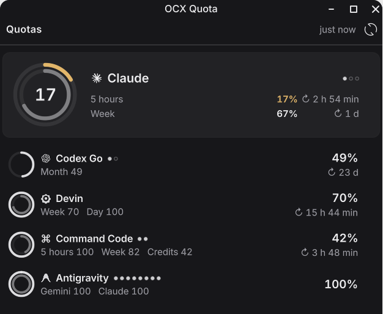
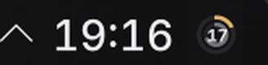

# OCX Quota

[](https://github.com/Hephaestus-Zero/ocx-plasma/actions/workflows/ci.yml)
[](https://github.com/Hephaestus-Zero/ocx-plasma/releases)


**Every AI coding subscription's remaining quota — Claude, Codex, Gemini/Antigravity, Devin, Command Code — in your KDE Plasma panel.**
A Plasma 6 widget for [opencodex](https://github.com/lidge-jun/opencodex) users: one concentric ring per subscription pool, all accounts of the same plan merged, resets counted down.




## Features

- **Pooled accounts** — multiple opencodex accounts on the same provider + plan are merged into one subscription pool; the ring shows the pool's remaining quota, not a single account's.
- **Concentric rings** — outer ring = short window (5 h / daily), inner ring = long window (weekly / monthly / credits). The arc is what is *left*.
- **Drag to reorder** — grab the grip on a popup row; the order persists and decides which pools get panel rings.
- **Account drill-down** — click a pool to unfold its accounts with per-account rings, paused and rate-limited states.
- **Theme-aware** — monochrome rings and provider logos that follow your color scheme; a ring turns amber/red only when its own window runs low.
- **Zero config** — sensible defaults out of the box; everything is still adjustable in the settings.
- **Self-contained** — the collector ships inside the package and is driven by the widget itself; no daemon, no systemd timer.

## Quick install

```sh
curl -fsSL https://raw.githubusercontent.com/Hephaestus-Zero/ocx-plasma/main/install.sh | bash
```

Then right-click a panel → **Add or Manage Widgets…** → search **OCX Quota** → drag it on.

### Manual

```sh
git clone https://github.com/Hephaestus-Zero/ocx-plasma
cd ocx-plasma
./install.sh          # or: make install
```

### KDE Store

Coming soon.

### Uninstall

```sh
./uninstall.sh        # or: make uninstall
```

## Requirements

- KDE Plasma ≥ 6 (`plasmashell --version`)
- `python3` ≥ 3.9 (standard library only)
- [opencodex](https://www.npmjs.com/package/@bitkyc08/opencodex): `npm i -g @bitkyc08/opencodex`, with at least one account (`ocx account add …`)
- `kpackagetool6` (usually in `plasma6-tools` / `kpackage`)

## How it works

```
 plasmashell
   └─ OCX Quota applet (panel / tooltip / popup)
        └─ executable data engine, every N s
             └─ python3 contents/code/ocx_pools.py json --max-age N
                  ├─ fresh?  → print $XDG_CACHE_HOME/ocx-plasma/pools.json
                  └─ stale   → ocx account list --quota --json
                               → group accounts into pools → write cache → print
```

All widget instances share the cache, so `ocx` is called at most once per refresh interval. If a refresh fails, the last cache is served with an "offline" marker.

## Configuration

Right-click the widget → **Configure OCX Quota…**

| Setting | Default | Meaning |
| --- | --- | --- |
| opencodex command | `ocx` | Command used to call opencodex (may contain arguments) |
| Refresh interval | `60` s | Polling + cache freshness window |
| Panel rings | `1` | How many pools (first in your order) get a panel ring |
| Hidden providers | `deepseek,kimi,openrouter` | Comma-separated ids never shown — the defaults are API-key providers without a quota window |
| Warn below | `25` % | Remaining % that turns a ring amber |
| Critical below | `10` % | Remaining % that turns a ring red |

Pool order is set by dragging rows in the popup; **Reset order** in the context menu restores the default (most-constrained first).

## Troubleshooting

| Symptom | Fix |
| --- | --- |
| "ocx not found" in the popup | `npm i -g @bitkyc08/opencodex`, then add an account |
| "python3 not found" | Install python3 via your distro |
| "No accounts found" | `ocx account add …`, or check the hidden-providers setting |
| "offline · …" | Last ocx call failed; the widget shows the stale cache — check `ocx account list --quota --json` in a terminal |
| Widget did not change after an update | `systemctl --user restart plasma-plasmashell.service` |

## Privacy

The collector runs `ocx account list --quota --json` on your machine and writes a local cache (`$XDG_CACHE_HOME/ocx-plasma/pools.json`). Nothing leaves the machine; there is no telemetry and no other file is read.

## Credits

- Provider logos are from [steipete/CodexBar](https://github.com/steipete/CodexBar) (MIT) — see `contents/icons/NOTICE` and `contents/icons/LICENSE-CodexBar`.
- Inspired by CodexBar and by KDE widget work in the same space (codexbar-kde, ai-usagebar).

## License

MIT © 2026 Hephaestus-Zero — see [LICENSE](LICENSE).
